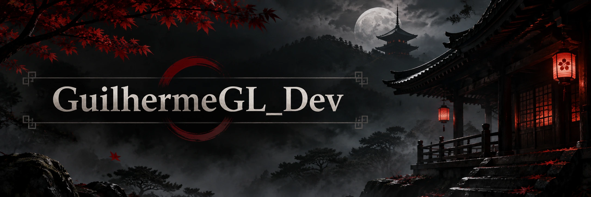
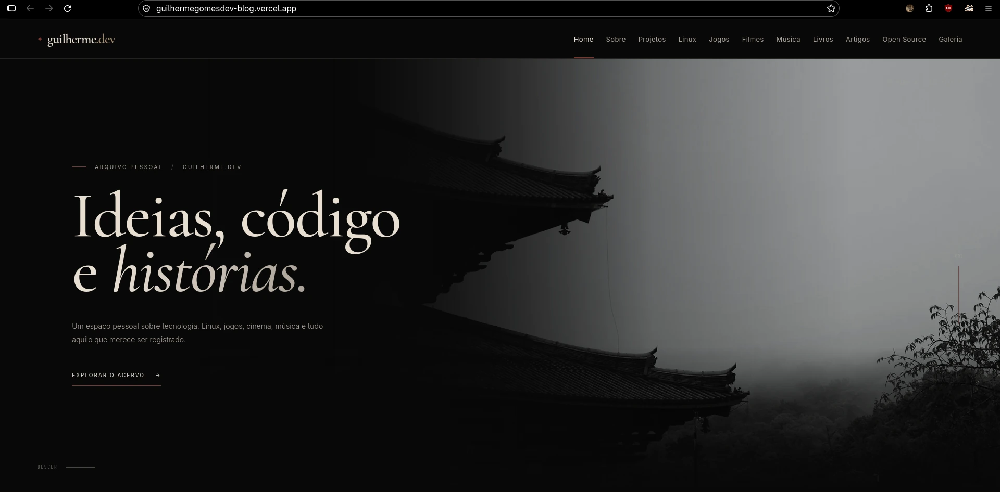
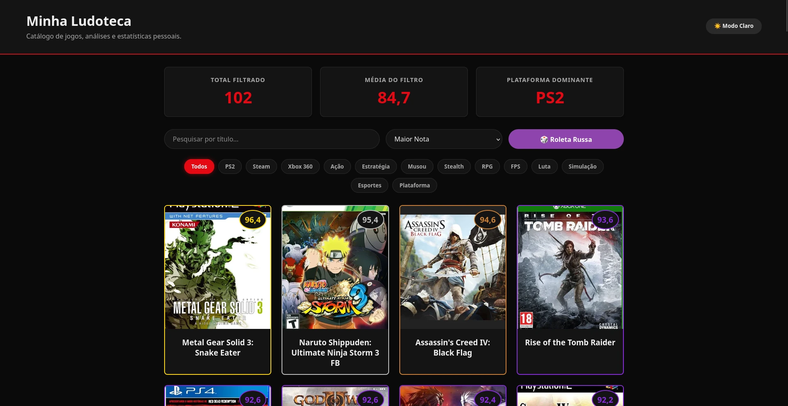

**Desenvolvedor em formação, com foco em desenvolvimento web.**

Este perfil reúne meus projetos pessoais e exercícios de programação.

## Sobre mim

Sou estudante de Análise e Desenvolvimento de Sistemas pela FAMINAS. Gosto de programação, Linux, tecnologia e história. Tenho interesse em desenvolvimento web e software livre e uso meus projetos pessoais para colocar o que aprendo em prática.

Quero trabalhar como programador e, a longo prazo, desenvolver meu próprio sistema operacional.

## Tecnologias e ferramentas

  <strong>Desenvolvimento web</strong> 
  
  
  
  
  
  <picture>
    <source media="(prefers-color-scheme: dark)" srcset="https://astro.build/assets/press/astro-icon-light-gradient.svg">
    
  </picture>
  

  <strong>Linguagens de programação</strong> 
  
  
  

  <strong>Banco de dados · SQL</strong> 
  

  <strong>Ambiente de desenvolvimento e versionamento</strong> 
  
  
  
  
  <picture>
    <source media="(prefers-color-scheme: dark)" srcset="https://github.githubassets.com/favicons/favicon-dark.svg">
    
  </picture>

## Projetos principais

### guilherme.dev-blog

Blog pessoal e portfólio sobre tecnologia, Linux e cultura, com artigos, catálogos e uma galeria. Desenvolvido com **Astro, TypeScript e Tailwind CSS**.

[Repositório do blog](https://github.com/Guilhermegomeslima/guilherme.dev-blog) · [Visitar o blog](https://guilhermegomesdev-blog.vercel.app/)

### ludoteca-digital-pessoal

Catálogo da minha coleção de jogos, com avaliações, busca, filtros e estatísticas por seleção. Desenvolvido com **HTML, CSS e JavaScript**.

[Repositório da ludoteca](https://github.com/Guilhermegomeslima/ludoteca-digital-pessoal) · [Abrir a ludoteca](https://guilhermegomeslima.github.io/ludoteca-digital-pessoal/)

## Outros projetos

- [A Chave para o Combate às Queimadas](https://guilhermegomeslima.github.io/Projeto-a-chave-para-o-combate-s-queimadas/) — Site educativo sobre prevenção de queimadas e ferramentas de alerta.
- [Minecraft Fan Site](https://guilhermegomeslima.github.io/minecraftfansite/) — Site de fãs sobre Minecraft e a Java Edition.
- [Exercícios de Java](https://github.com/Guilhermegomeslima/exercicios-java) — Exercícios de programação orientada a objetos.
- [BloomTech Gardens](https://guilhermegomeslima.github.io/BloomTech-Gardens/) — Landing page acadêmica sobre soluções de irrigação.

## Contatos

   
  GuilhermeGL_Dev

